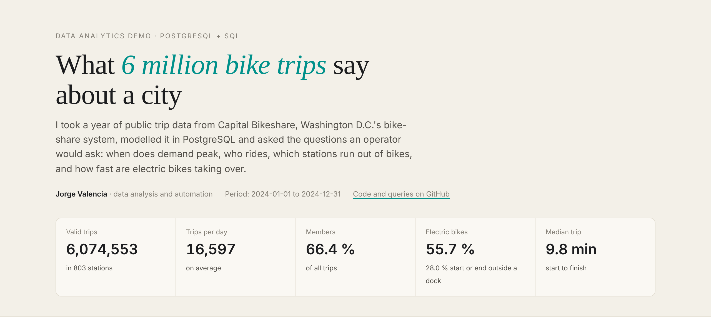
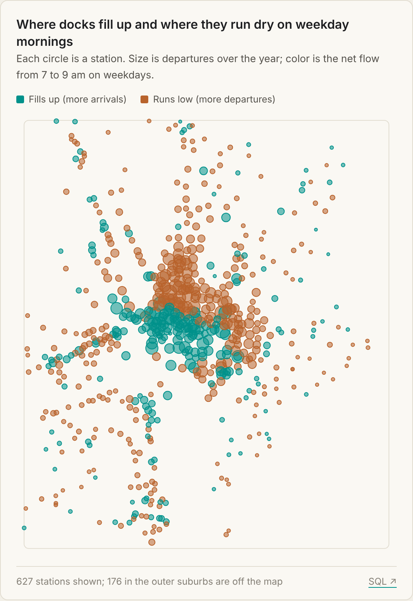
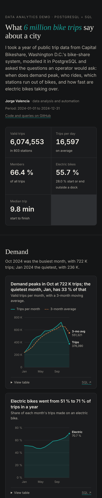
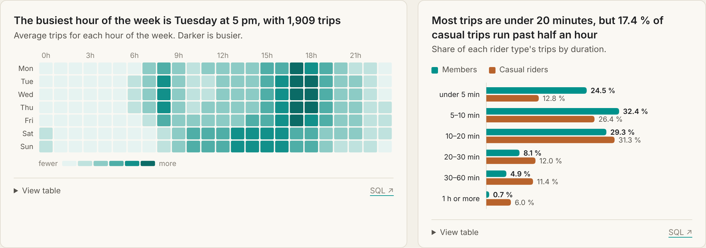
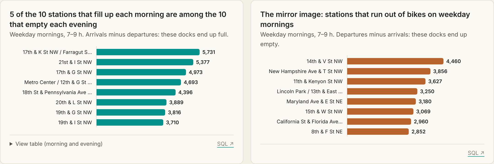

# Capital Bikeshare: bike-share analytics with PostgreSQL

I took a full year (2024) of public trip data from Capital Bikeshare, the bike-share system of Washington D.C., loaded it into PostgreSQL and asked the questions an operator would ask: when does demand peak, who rides and why, which stations run out of bikes, and how fast are electric bikes taking over. 6.1 million trips, 804 stations.

**Live dashboard:** https://jorvalfe6-byte.github.io/bikeshare-sql-analytics/

The dashboard is a single static page. It reads a 115 KB JSON with already-aggregated results (plus the location of each station) and draws every chart, including the station map, with no external libraries and no map tiles.





<p align="center"></p>

## What I found

- **Demand is seasonal and strong.** Trips grow from 236 thousand in January to 722 thousand in October, the busiest month. The quietest month carries a third of the peak's traffic.
- **Electric bikes are taking over.** They were 51 % of trips in January and 71 % in December. 28 % of all trips start or end outside a dock, which only electric bikes (and a few strays) can do.
- **Members commute, casual riders wander.** On weekdays there are two peaks, at 8 am and 5 pm, and members drive both. Casual riders take trips 44 % longer (12.5 vs 8.7 minutes median) and are four times more likely to end where they started (5.2 % vs 1.3 % round trips).
- **The commute makes the docks flow like a tide.** 5 of the 10 stations that fill up on weekday mornings are among the 10 that empty out in the evening. A rebalancing crew would plan its day around that.
- **Demand is concentrated.** The top 10 % of stations start 41.6 % of all trips, and the top 20 % start 65 %. Columbus Circle / Union Station alone starts 1.1 %.
- **The week has a shape.** The busiest hour is Tuesday at 5 pm, with about 1,900 trips; weekends have no commute and peak in the afternoon.
- **Electric bikes are faster and go farther.** Median net speed is 12.3 km/h against 9.1 for classic bikes, and a median 1.9 km against 1.5 km (straight-line distance, so both are lower bounds).
- **Casual riders linger.** 17 % of their trips run past half an hour, against 6 % for members.
- **Round trips cluster at parks and monuments.** Gravelly Point, the National Mall and Lincoln Memorial lead, with the top three at over 90 % casual riders and trips of 30 to 50 minutes.





## How it is built

```
CSV ──\copy──▶ staging ──transform──▶ core ──▶ mart ──▶ dashboard.json ──▶ docs/index.html
(12 files,      (all TEXT)      (typed, PK/FK/CHECK,   (materialized view,    (aggregates only)
 as published)                   duplicates removed)    validity per trip)
                                    │
                                    └──▶ audit.load_log (rows read vs. rows loaded)
```

| Layer | What it does |
|---|---|
| `staging` | Receives the 12 monthly CSV files as text, untouched. A strange value cannot stop the load. |
| `core` | Typed model with primary keys, foreign keys and `CHECK`s. Keeps every trip, minus 141 duplicates. The transformation runs in one transaction and can be repeated without duplicating anything. |
| `audit` | One row per table per load: how many rows came in and how many stayed. |
| `mart` | `fact_trip`, a materialized view with one row per trip, its derived fields and whether it is valid and why not. All analysis reads from here. |

### Data model


## The queries

Every file in `sql/analysis/` runs on its own, and its header says what each result row represents.

| File | Question | Techniques |
|---|---|---|
| `00_data_quality.sql` | Did the load come out complete? | 14 checks against the published files |
| `01_kpis.sql` | Executive summary | `PERCENTILE_CONT`, `FILTER` |
| `02_monthly_usage.sql` | Monthly demand | Calendar from `generate_series`, `LAG` for month-over-month, moving average, `RANK` |
| `03_hourly_pattern.sql` | When do people ride? | Weekday vs weekend normalised per day, share of day with a window `SUM`, peak rank |
| `04_members_vs_casual.sql` | Who rides and why? | Percentiles, conditional aggregates for commute hours and round trips |
| `05_electric_adoption.sql` | How fast do electric bikes grow? | Share of month with a window over the partition |
| `06_station_ranking.sql` | Which stations matter? | `RANK`, `PERCENT_RANK` concentration |
| `07_rebalancing.sql` | Which docks fill or empty at rush hour? | Net flow per station and period, top-N both ways with `ROW_NUMBER` |
| `08_routes.sql` | Most common routes and round-trip hotspots | Joins to the station dimension, grouped percentiles |
| `09_peak_days.sql` | Busiest and quietest days | Day-of-week baseline with a window `AVG`, top and bottom 5 |
| `10_weekday_hour_heatmap.sql` | Demand across the 168 hours of the week | Normalised per day count, index against the peak cell |
| `11_distance_speed.sql` | How far and how fast, by bike type | Haversine distance in plain SQL, percentiles of net speed |
| `12_duration_distribution.sql` | How long do trips last? | Buckets with a window `SUM` over filtered counts |

## Decisions and problems I found in the data

- **A valid trip is a plausible trip.** The mart flags, instead of deleting, trips that end before they start (1,101), that last under a minute and return to the same dock (33,517) or last over 24 hours (5,011). That is 39,629 trips, 0.65 % of the data. The reason stays in `invalid_reason`, so anyone can disagree with the rule and change it in one place.
- **141 trips appear twice.** A trip that crosses midnight at the end of a month is published in both monthly files, once with millisecond timestamps. I keep one copy (the more precise one) and log the count. The load check expects exactly 141.
- **The April 2024 file is mislabeled.** The zip for April contains a file named `202004-…`. Its trips are from April 2024. The download script names each file after the month in the zip's own name, not the one inside.
- **Electric bikes can be left anywhere.** 1.2 million trips have no start or end station, and that is real, not missing data. 4,908 classic-bike trips (0.18 %) also end with no station: the bike was not returned to a dock.
- **Station ids were renamed during the year.** 15 ids have more than one name, and two names exist under two ids. Each id keeps its most frequent name. Both ids stay.
- **Timestamps have no time zone.** They are local to Washington D.C., so I use `TIMESTAMP`, not `TIMESTAMPTZ`. On 2024-11-03 the clocks go back one hour, which this format cannot represent: 60 trips that day end "before" they start and fall in the excluded group.
- **GPS glitches get no distance.** 51 trips have coordinates outside the D.C. metro area. They stay in the data, but their distance is NULL, so no 100 km trip distorts the medians. Distances are straight-line (haversine), which understates the real path.
- **Station coordinates come from the dock, not the average.** Docked bikes report the exact dock coordinates; electric bikes report GPS points that scatter. The most repeated pair is the station.
- **A trap I fell into and fixed.** A comparison against a missing station makes a flag NULL, not false, and a NULL flag quietly dropped 18,262 trips from every analysis until I checked the totals. The flags now test for NULL explicitly.

## How to run it

You need PostgreSQL 14 or newer, `psql` and Python 3.

```bash
createdb bikeshare
export PGDATABASE=bikeshare          # plus PGHOST / PGUSER if needed
./scripts/download_data.sh           # 12 files, about 240 MB zipped
./scripts/load.sh                    # schema, load, transform, views and checks
./scripts/export_dashboard.sh        # regenerates docs/data/dashboard.json
```

The full load takes about three minutes on my machine (the first push to GitHub ran it end to end in under four). At the end it prints the data-quality checks, which must all say `OK`; if any says `REVIEW`, the script exits with an error. Every push runs this same load in GitHub Actions and compares the exported JSON with the one in the repository.

The dashboard is served by GitHub Pages straight from `docs/` (Settings → Pages → Deploy from a branch → `main` → `/docs`).

To see the dashboard locally:

```bash
python3 -m http.server --directory docs
```

The expected values in the checks correspond to the 2024 files as published when I wrote this. If the operator republishes a file with corrections, a check will say `REVIEW` on purpose.

## Structure

```
sql/
  01_schema.sql            schemas, tables and constraints
  02_transform.sql         staging → core, audit and indexes
  03_marts.sql             fact_trip with the validity rules
  04_dashboard_views.sql   views that feed the dashboard
  analysis/                one query file per question (00 = checks, 01–12 = analysis)
scripts/
  download_data.sh         fetches the 12 monthly files
  load.sh                  end-to-end load and checks
  export_dashboard.sh      exports aggregates to JSON
docs/
  index.html               dashboard (GitHub Pages)
  data/dashboard.json      aggregated results
  img/                     screenshots used in this README
data/                      raw CSV files (not committed)
```

## License

- **Data:** [Capital Bikeshare system data](https://capitalbikeshare.com/system-data), under the [Capital Bikeshare Data License Agreement](https://capitalbikeshare.com/data-license-agreement). The raw files are not in the repository; `docs/data/` contains aggregates and station locations only.
- **Code** (SQL, scripts and page): MIT, see [LICENSE](LICENSE).

---

**Jorge Valencia**, data analysis and automation. If you have business data in spreadsheets or in a system that gives you no reports, this is the kind of work I do.
